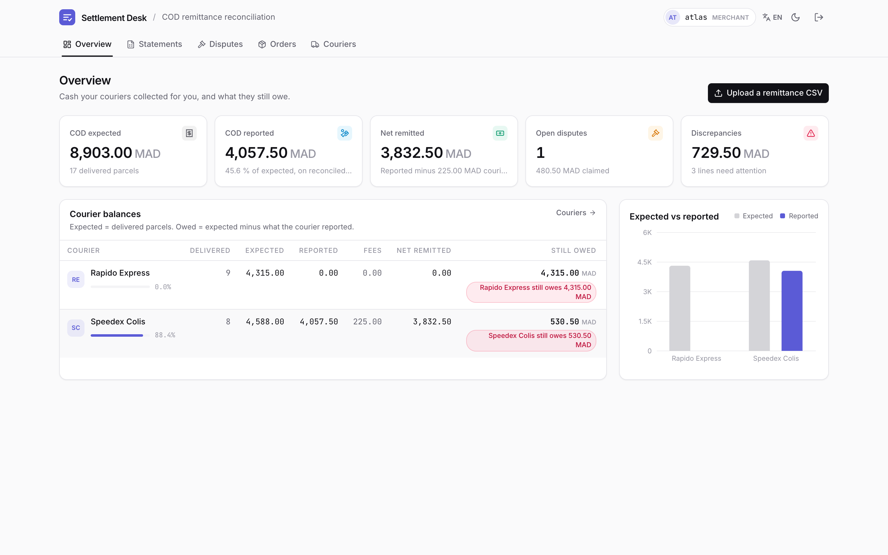
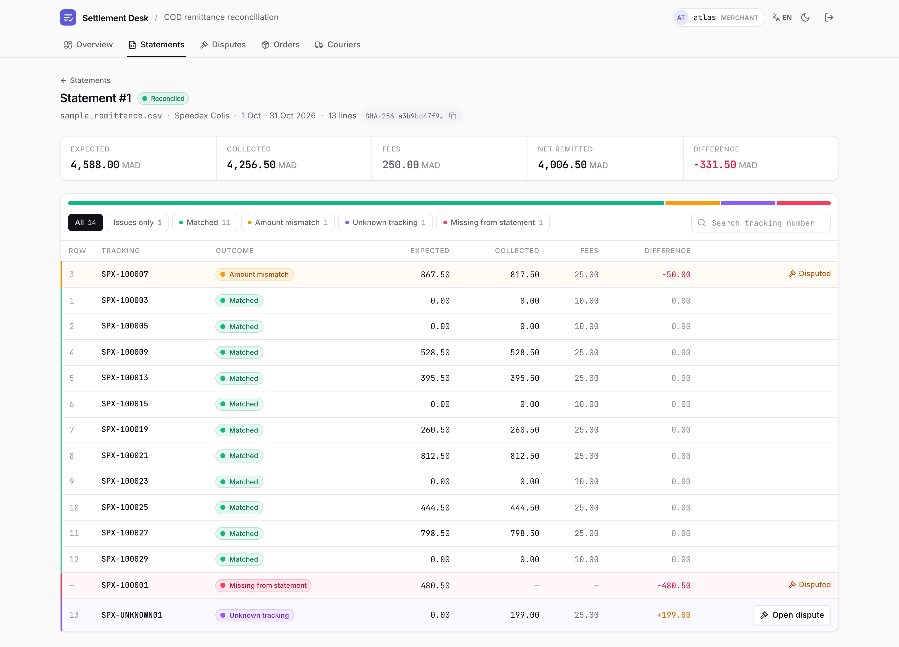
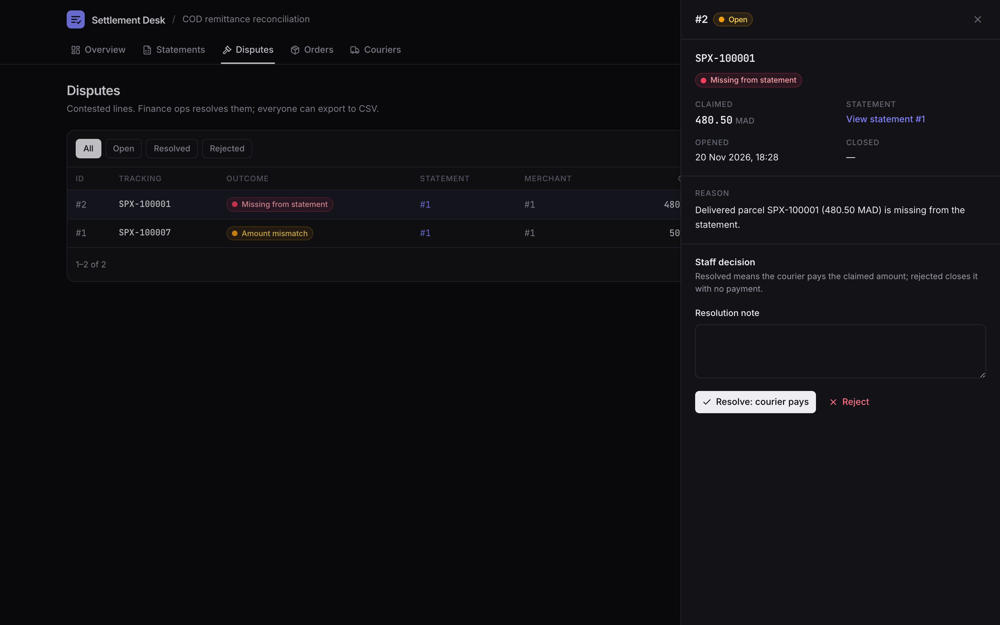
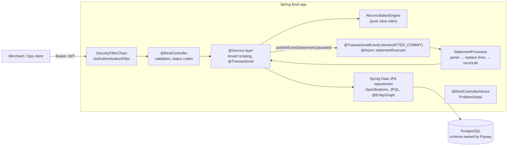

# spring-cod-settlement

A Spring Boot REST API that settles **cash-on-delivery (COD)** money between e-commerce
merchants and the courier companies that collect cash at the customer's door.

Couriers send merchants a periodic **remittance CSV** ("these are the parcels we delivered,
the cash we collected and the fee we kept"). This service ingests those files, **reconciles
every line against the merchant's orders**, flags discrepancies, computes how much cash each
courier still owes, and lets merchants open and export **disputes**.

It is the Java port of [django-cod-settlement](https://github.com/AmineBenzaazaa/django-cod-settlement):
same domain and rules, written the way a Spring team would write it.



Stack: Java 21 · Spring Boot 3.5 · Spring Web · Spring Data JPA / Hibernate 6 · PostgreSQL 16 ·
Flyway · Spring Security (stateless JWT) · Bean Validation · MapStruct · springdoc-openapi ·
JUnit 5 · Mockito · Testcontainers · JaCoCo · Docker · GitHub Actions.

---

## Features

- **JWT auth** (access + refresh tokens), roles `MERCHANT` and `STAFF`, and **per-merchant data
  isolation** enforced in the service/repository layer (a foreign ID is a 404, never a leak).
- **Orders and couriers** with filtering, free-text search, sorting (allow-listed) and pagination.
  Order status only changes through delivery attempts, so the lifecycle stays valid.
- **CSV remittance upload**: validated synchronously (every row error reported at once), stored,
  then processed **asynchronously after commit** (`@Async` + `@TransactionalEventListener`).
  Uploading the same bytes twice is a no-op thanks to a **SHA-256 content hash**.
- **Reconciliation engine** (pure Java, no Spring): matched, amount mismatch, unknown tracking
  number, delivered-but-missing-from-statement.
- **Courier balance**: expected collections vs reported collections, fees, net remitted, balance owed.
- **Disputes** on any non-matched result, staff resolution with optimistic locking, **CSV export**
  protected against formula injection.
- **RFC 7807 ProblemDetail** errors everywhere (validation, 401/403 from the security chain, 404,
  409, 422, 500 without leaking internals).
- **OpenAPI 3** + Swagger UI, Actuator health/readiness probes, `demo` profile with seed data.
- **Settlement Desk web UI** (React + TypeScript) for merchants and finance ops, see below.
- **205 backend tests + 40 Vitest + 1 Playwright e2e**, JaCoCo coverage gate in `mvn verify` (currently 96 % of lines overall, 99 % in the service layer).

## Web UI: Settlement Desk

A React web app in [`web/`](web/) for merchants and finance ops, served by nginx at
**http://localhost:3200** (it proxies `/api` to the Spring Boot app, so the browser sees one origin
and the API needs no CORS setup).

| Reconciliation of a courier statement | Dispute resolution (finance ops, dark mode) |
|---|---|
|  |  |

- **Overview**: COD expected vs reported, net remitted, open disputes and the discrepancy amount,
  plus a per-courier balance table ("Speedex Colis still owes 530.50 MAD") and a chart
  (one call to `GET /api/overview`).
- **Statements**: drag-and-drop CSV upload (courier + period), an upload history that polls
  while processing runs, the SHA-256 duplicate notice, and every rejected row from the 400.
- **Reconciliation**: lines colour-coded MATCHED / AMOUNT_MISMATCH / UNKNOWN_TRACKING /
  MISSING_FROM_STATEMENT with expected, collected and signed difference, filters, and a
  one-click prefilled "Open dispute".
- **Disputes**: list, detail drawer, staff-only resolution (controls hidden for merchants, 403
  from the API anyway), CSV export through the existing endpoint.
- **Orders and couriers**: searchable, paginated tables; orders expand to their delivery attempts.
- Light/dark and EN/FR, same design tokens as the
  [parcel-platform](https://github.com/AmineBenzaazaa/spring-parcel-platform) dashboard.

Stack: Vite, React 18, TypeScript (strict), Tailwind, TanStack Query, React Router, Radix Dialog,
Recharts. Money is formatted from the API's decimal strings with BigInt cents, never floats.

**Demo (2 minutes)**

1. `docker compose up --build -d`, open http://localhost:3200. The login is prefilled with
   `atlas`; demo chips switch to `medina` or `ops` (password `demo-pass-123`).
2. As **atlas**, open *Statements*, pick *Speedex Colis*, period 2026-10-01 to 2026-10-31, drop
   `fixtures/sample_remittance.csv`. The row goes Queued, Processing, Reconciled on its own.
   Upload it again to see the SHA-256 duplicate notice.
3. Open the statement: 11 matched lines, one short payment (−50.00), one unknown tracking
   number (+199.00) and one delivered parcel missing from the file. Click *Open dispute*.
4. Sign out, sign in as **ops**, open *Disputes*, click the dispute, resolve it. *Export CSV*
   downloads the list.

```bash
cd web
npm ci
npm run dev          # http://localhost:5174, proxies /api to localhost:18080
npm test             # Vitest: money, API client and refresh, polling hook, components
npm run e2e          # Playwright against the compose stack on :3200
```

## Architecture



```
src/main/java/com/benzaazaa/codsettlement/
  account/      Merchant (tenant) and AppUser entities + repositories
  auth/         POST /api/auth/login, /refresh, GET /me
  security/     SecurityConfig, JwtService, JwtAuthenticationFilter, TenantSpecifications
  logistics/    Courier, Order, DeliveryAttempt: domain, repositories, services, controllers, MapStruct mapper
  settlement/   Statements, lines, reconciliation results, disputes, balance
    service/    RemittanceCsvParser, StatementIngestionService, ReconciliationEngine,
                ReconciliationService, StatementProcessor (+ async listener), CourierBalanceService,
                DisputeService, DisputeCsvWriter
  common/       Money (BigDecimal rules), ProblemDetail handler, PageResponse, SortGuard
  config/       Async executor, JPA auditing, Clock, OpenAPI
  demo/         DemoDataSeeder (CommandLineRunner, @Profile("demo"))
src/main/resources/db/migration/   V1..V4 Flyway migrations
```

Each feature package follows the same layout (`domain`, `repository`, `service`, `web`, `web/dto`,
`mapper`). Dependencies point one way: `settlement → logistics → account`. Controllers are thin,
services hold the rules, entities protect their own invariants (no public setters).

## How reconciliation works

A statement is always **one courier × one merchant × one period**.

```mermaid
flowchart TD
    L[CSV line: tracking, collected, fee] --> Q{Order with this tracking<br/>for this courier + merchant?}
    Q -- no --> U[UNKNOWN_TRACKING]
    Q -- yes --> E["expected = amountDue if DELIVERED,<br/>else 0 (returned parcels collect nothing)"]
    E --> C{collected.compareTo(expected) == 0?}
    C -- yes --> OK[MATCHED]
    C -- no --> MM["AMOUNT_MISMATCH<br/>difference = collected − expected"]
    D[Orders delivered in the period] --> N{On this statement, or already<br/>settled on another one?}
    N -- neither --> MS[MISSING_FROM_STATEMENT]
```

1. `ReconciliationEngine.classify()` is a **pure function** over records (`LineData`, `OrderData`),
   so every rule is unit-tested in microseconds without Spring or a database.
2. `ReconciliationService.reconcile()` locks the statement (`SELECT ... FOR UPDATE`), loads lines
   and the relevant orders in **two queries**, runs the engine, replaces previous results and links
   each line to its order, all in one transaction. Running it twice gives the same result.
3. It refuses to run once a result is under dispute (409), so dispute evidence is never destroyed.
4. Period boundaries are computed in `Africa/Casablanca` (Moroccan business days).

**Courier balance** (`GET /api/couriers/{id}/balance`):

```
expectedCollections = Σ amountDue of DELIVERED orders
reportedCollections = Σ amountCollected on reconciled lines linked to the courier's orders
fees                = Σ fee on those lines
netRemitted         = reportedCollections − fees        (what actually reached the bank)
balanceOwed         = expectedCollections − reportedCollections
```

## Running it

### Docker (web UI + app + PostgreSQL, demo data included)

```bash
docker compose up --build -d
open http://localhost:3200                    # Settlement Desk web UI
curl localhost:18080/actuator/health          # {"status":"UP",...}
open http://localhost:18080/swagger-ui.html   # click "Authorize", paste an access token
docker compose down                           # add -v to drop the database volume
```

Host ports default to **3200** (web), **18080** (API) and **15433** (PostgreSQL) so the stack runs
next to other local projects; override with `WEB_PORT`, `APP_PORT` and `DB_PORT`. The app
container is capped at 512 MB with the heap at 50 % of it (`-XX:MaxRAMPercentage=50`).

Demo users (password `demo-pass-123`): `ops` (STAFF), `atlas` and `medina` (MERCHANT).
`fixtures/sample_remittance.csv` matches the seeded orders of `atlas` with courier `speedex` (id 1).

### Local (JDK 21 + a PostgreSQL)

```bash
docker compose up -d db                      # or any PostgreSQL 16
cp .env.example .env && set -a && source .env && set +a
./mvnw spring-boot:run
```

`APP_JWT_SECRET` is required (32+ characters): the app refuses to start without it.

### Tests

```bash
./mvnw test      # unit + @WebMvcTest slices (no Docker needed)
./mvnw verify    # + Testcontainers PostgreSQL integration tests, JaCoCo report and coverage gate
open target/site/jacoco/index.html
```

| Layer | Tool | Count |
|---|---|---|
| Pure rules, services | JUnit 5, Mockito, AssertJ | 140 |
| Controllers + security | `@WebMvcTest` + real `SecurityFilterChain` + real JWTs | 36 |
| Repositories | `@DataJpaTest` on Testcontainers PostgreSQL | 9 |
| End to end | `@SpringBootTest` + MockMvc + Testcontainers + Awaitility | 20 |
| Web UI | Vitest + Testing Library (`cd web && npm test`) | 40 |
| Browser e2e | Playwright through nginx (`cd web && npm run e2e`) | 1 |

Unit and slice tests run with Surefire (`*Test`), Testcontainers tests with Failsafe (`*IT`);
JaCoCo merges both into one report.

## API examples

```bash
# 1. Log in (access token 15 min, refresh token 7 days)
TOKEN=$(curl -s -X POST localhost:18080/api/auth/login -H 'Content-Type: application/json' \
  -d '{"username":"atlas","password":"demo-pass-123"}' | jq -r .accessToken)
AUTH="Authorization: Bearer $TOKEN"

# 2. Delivered orders over 300 MAD, most expensive first, searching by customer
curl -s "localhost:18080/api/orders?status=DELIVERED&minAmount=300&q=alaoui&sort=amountDue,desc&size=10" -H "$AUTH"

# 3. Create an order (merchant comes from the token, never from the body)
curl -s -X POST localhost:18080/api/orders -H "$AUTH" -H 'Content-Type: application/json' \
  -d '{"courierId":1,"trackingNumber":"SPX-900001","customerName":"Sara Tazi","city":"Rabat","amountDue":"349.90"}'

# 4. Record a delivery attempt (moves the order to DELIVERED)
curl -s -X POST localhost:18080/api/orders/1/attempts -H "$AUTH" \
  -H 'Content-Type: application/json' -d '{"outcome":"DELIVERED"}'

# 5. Upload a courier remittance CSV -> 202 Accepted, reconciled in the background
curl -s -X POST localhost:18080/api/statements -H "$AUTH" \
  -F file=@fixtures/sample_remittance.csv -F courierId=1 \
  -F periodStart=2026-10-01 -F periodEnd=2026-10-31
#    same file again -> 200 {"duplicate":true,"statement":{"id":1,...}}

# 6. Reconciliation report (optionally ?outcome=AMOUNT_MISMATCH)
curl -s localhost:18080/api/statements/1/reconciliation -H "$AUTH"
# "summary":{"counts":{"MATCHED":11,"AMOUNT_MISMATCH":1,"UNKNOWN_TRACKING":1,"MISSING_FROM_STATEMENT":1},
#            "expectedTotal":"4588.00","collectedTotal":"4256.50","feesTotal":"250.00",...}

# 7. What does this courier still owe me?
curl -s localhost:18080/api/couriers/1/balance -H "$AUTH"
# {"courierId":1,"merchantId":1,"currency":"MAD","deliveredOrders":8,"expectedCollections":"4588.00",
#  "reportedCollections":"4057.50","fees":"225.00","netRemitted":"3832.50","balanceOwed":"530.50"}

# 7b. Everything the dashboard needs in one call: totals, open disputes, discrepancies, per-courier rows
curl -s localhost:18080/api/overview -H "$AUTH"

# 8. Dispute a discrepancy (claimedAmount defaults to the full difference), then export
curl -s -X POST localhost:18080/api/disputes -H "$AUTH" -H 'Content-Type: application/json' \
  -d '{"resultId":3,"reason":"Courier short-paid 50 MAD"}'
curl -s "localhost:18080/api/disputes/export?status=OPEN" -H "$AUTH" -o disputes.csv

# 9. Errors are RFC 7807 ProblemDetail
curl -s "localhost:18080/api/orders?sort=password" -H "$AUTH"
# {"type":".../problems/invalid-request","title":"Invalid request","status":400,
#  "detail":"Cannot sort by 'password'. Allowed: amountDue, createdAt, ...","errors":{"sort":[...]}}
```

CSV format expected from couriers (header required, column order free, extra columns ignored):

```csv
tracking_number,amount_collected,fee
SPX-100007,817.50,25.00
SPX-100003,0.00,10.00
```

## Design decisions

**Money is `BigDecimal`, never `double`.** Columns are `numeric(12,2)`. `Money.parse` *rejects*
input with more than two decimals (a courier file saying `10.005` is a data problem, not something
to round silently), totals are normalized to scale 2 with `HALF_UP`, amounts are compared with
`compareTo` (because `new BigDecimal("10.0").equals(new BigDecimal("10.00"))` is `false`), and JSON
carries money as strings (`"349.90"`) so JavaScript clients never see a float.

**Idempotent uploads via SHA-256.** The upload hashes the bytes; a unique constraint on
`(merchant_id, file_sha256)` makes a re-upload return the existing statement. The constraint, not
the pre-check, is the real guard: two concurrent identical uploads cannot both insert. The loser
catches `DataIntegrityViolationException` *after* its transaction rolled back (that is why the
insert uses `TransactionTemplate`) and returns the winner. Scoped per merchant so one tenant can
never detect another tenant's file.

**Async after commit.** The upload publishes `StatementUploadedEvent` inside its transaction. A
`@TransactionalEventListener(phase = AFTER_COMMIT)` + `@Async` listener starts processing on a
bounded thread pool only once the row is committed (Django: `transaction.on_commit` + Celery).
If the upload rolls back, nothing runs. Processing is idempotent and row-locked, and a full queue
falls back to `CallerRunsPolicy` (back-pressure, no lost work). Trade-off: an in-process executor
loses queued jobs if the JVM dies; statements then stay `UPLOADED` and staff can re-run them with
`POST /api/statements/{id}/reprocess`. A production version at scale would use a transactional
outbox or a broker (RabbitMQ/Kafka).

**Tenant isolation in the data layer.** Every tenant-owned query is AND-ed with
`TenantSpecifications.visibleTo(user, ...)`, so foreign IDs are 404 (they do not exist for the
caller) and lists cannot leak rows. On writes the merchant always comes from the token. A database
check constraint guarantees `MERCHANT` users have a merchant and `STAFF` users do not.

**Stateless JWT.** The access token carries user id, role and merchant id, so a request needs no
session and no database lookup. Refresh reloads the user, so a disabled account cannot refresh. A
`typ` claim stops refresh tokens from being used as access tokens. Trade-off: access tokens cannot
be revoked before they expire (hence 15 minutes).

**No lazy loading in the web layer.** `spring.jpa.open-in-view=false`; services build DTOs
inside their transaction. N+1 queries are avoided with `@EntityGraph` (courier on order pages),
`@BatchSize` (attempts), `left join fetch` (results + lines) and SQL aggregates for totals. A
repository test asserts that mapping a page of 10 orders with attempts uses at most 3 statements.

**Flyway owns the schema.** `ddl-auto=validate`: Hibernate only checks that entities match the
migrations. Constraints (unique, check, FK `RESTRICT` on disputed results) live in the database
as the last line of defence.

**Testcontainers, not H2.** Tests run against the same PostgreSQL 16 as production, so row locks,
`numeric` arithmetic, `bytea`, `timestamptz` and check constraints behave exactly as they will live.

## Django vs Spring: same domain, two stacks

| Concern | Django version | Spring version |
|---|---|---|
| Web layer | DRF `ViewSet` + router | `@RestController` + `@RequestMapping` |
| Input validation | DRF `Serializer` | DTO `record` + Bean Validation (`@NotNull`, `@Digits`, custom `@ValidPeriod`) |
| Output shape | `ModelSerializer` | `record` DTOs mapped by MapStruct (compile-time) |
| ORM | Django ORM, `QuerySet` | Spring Data JPA / Hibernate, `Specification`, JPQL |
| Filtering | `django-filter` `FilterSet` | `Specification` composition from a filter `record` |
| Migrations | `makemigrations` / `migrate` | Flyway SQL files (`V1__...sql`), `ddl-auto=validate` |
| Auth | SimpleJWT | Spring Security filter chain + jjwt, custom `OncePerRequestFilter` |
| Permissions | `BasePermission` + queryset mixin | URL rules, `@PreAuthorize`, `TenantSpecifications` |
| Transactions | `ATOMIC_REQUESTS`, `transaction.atomic` | `@Transactional` on services, `TransactionTemplate` |
| Background jobs | Celery + Redis, `on_commit(delay)` | `@Async` executor + `@TransactionalEventListener(AFTER_COMMIT)` |
| Row lock | `select_for_update()` | `@Lock(PESSIMISTIC_WRITE)` |
| Money | `Decimal`, `DecimalField(12,2)` | `BigDecimal`, `numeric(12,2)`, scale 2 `HALF_UP` |
| Errors | DRF exception handler | `@RestControllerAdvice` → RFC 7807 `ProblemDetail` |
| API docs | drf-spectacular | springdoc-openapi |
| Seed data | `manage.py seed_demo` | `CommandLineRunner` in `@Profile("demo")` |
| Tests | pytest + factory_boy, SQLite/PostgreSQL | JUnit 5 + Mockito + `@WebMvcTest` + `@DataJpaTest` + Testcontainers |
| Coverage | coverage.py | JaCoCo (merged unit + integration) |

## Interview guide

[`docs/INTERVIEW-GUIDE.md`](docs/INTERVIEW-GUIDE.md) maps NestJS and Django concepts to Spring, walks
through one request file by file, and lists likely interview questions about this codebase.

## License

MIT, see [LICENSE](LICENSE).
