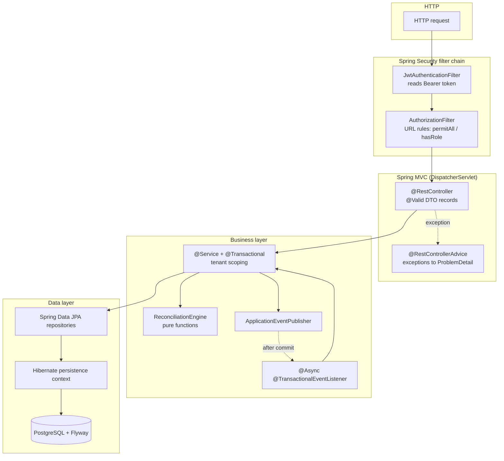
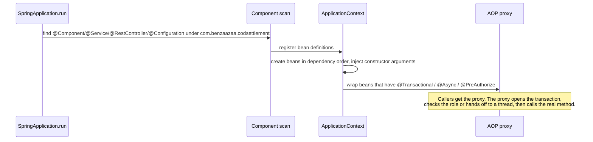
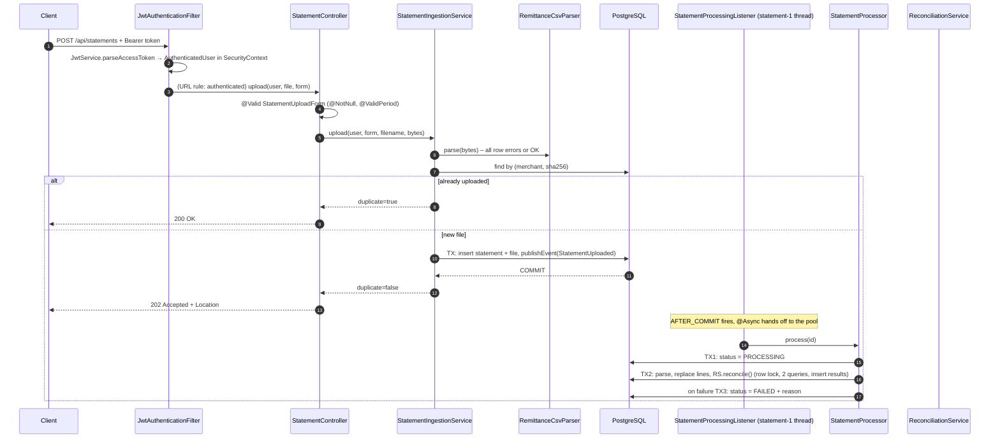
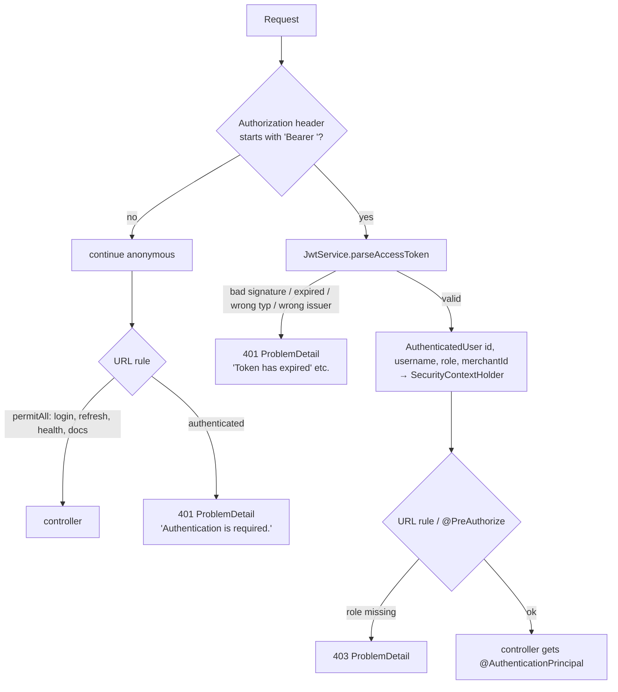

# Interview guide: spring-cod-settlement

How this codebase works, written for someone who already knows NestJS and Django. Pictures
first, then the files, then the questions an interviewer is likely to ask.

Contents

1. [The big picture in one diagram](#1-the-big-picture-in-one-diagram)
2. [NestJS / Django to Spring, concept by concept](#2-nestjs--django-to-spring-concept-by-concept)
3. [How Spring wires things together (DI and proxies)](#3-how-spring-wires-things-together-di-and-proxies)
4. [One request end to end: uploading a remittance CSV](#4-one-request-end-to-end-uploading-a-remittance-csv)
5. [The JWT filter flow](#5-the-jwt-filter-flow)
6. [Transactions and the persistence context](#6-transactions-and-the-persistence-context)
7. [Testing pyramid](#7-testing-pyramid)
8. [25 likely interview questions about this codebase](#8-25-likely-interview-questions-about-this-codebase)
9. [Two-minute pitch](#9-two-minute-pitch)

---

## 1. The big picture in one diagram



Read it top to bottom: **filters** (security) run before Spring MVC, **controllers** only deal with
HTTP, **services** own the rules and the transaction, **repositories** talk to the database. The
async listener is how the upload hands work to a background thread once the data is committed.

---

## 2. NestJS / Django to Spring, concept by concept

| You know (NestJS) | You know (Django/DRF) | Spring equivalent | Where in this repo |
|---|---|---|---|
| `@Module({ providers })` | `INSTALLED_APPS` | Component scan from `@SpringBootApplication` + `@Configuration` classes | `CodSettlementApplication`, `config/*` |
| `@Injectable()` provider | plain class / function | `@Service`, `@Component`, `@Repository` (all are "beans") | `OrderService`, `RemittanceCsvParser` |
| `useFactory` provider | settings-based factory | `@Bean` method inside a `@Configuration` class | `AsyncConfig.statementExecutor()`, `ClockConfig.clock()` |
| Constructor injection | n/a | Constructor injection (no `@Autowired` needed with one constructor) | every service |
| `ConfigService` / `.env` | `settings.py` + django-environ | `application.yml` + `@ConfigurationProperties` record + `${ENV:default}` | `JwtProperties`, `application.yml` |
| Controller `@Get()` | `ViewSet` + router | `@RestController` + `@GetMapping` | `OrderController` |
| DTO + `class-validator` | `Serializer` validation | `record` DTO + Bean Validation (`@NotBlank`, `@Digits`) + `@Valid` | `OrderCreateRequest` |
| `ValidationPipe` | `serializer.is_valid()` | `@Valid` on the parameter; failures become `MethodArgumentNotValidException` | `GlobalExceptionHandler.handleMethodArgumentNotValid` |
| Custom validator | `validate()` on serializer | Custom constraint annotation + `ConstraintValidator` | `@ValidPeriod`, `ValidPeriodValidator` |
| Guard (`CanActivate`) | `BasePermission` | `SecurityFilterChain` URL rules + `@PreAuthorize` | `SecurityConfig`, `StatementController.reprocess` |
| Passport JWT strategy | SimpleJWT | `OncePerRequestFilter` that sets the `SecurityContext` | `JwtAuthenticationFilter` |
| `@Req() req.user` | `request.user` | `@AuthenticationPrincipal AuthenticatedUser user` | every controller |
| Interceptor | middleware | Servlet `Filter` (before MVC) or AOP aspect around beans | `JwtAuthenticationFilter`; `@Transactional` itself is AOP |
| Exception filter | `EXCEPTION_HANDLER` | `@RestControllerAdvice` + `@ExceptionHandler` | `GlobalExceptionHandler` |
| TypeORM entity | Django model | JPA `@Entity` (Hibernate) | `Order`, `RemittanceStatement` |
| TypeORM repository | `Model.objects` manager | `interface ... extends JpaRepository<Order, Long>` (implemented at runtime) | `OrderRepository` |
| QueryBuilder | `QuerySet.filter()` chains | `Specification` (Criteria API) or `@Query` JPQL | `OrderSpecifications`, `SettlementOrderRepository` |
| `relations: [...]` | `select_related` / `prefetch_related` | `@EntityGraph`, `join fetch`, `@BatchSize` | `OrderRepository.findAll`, `Order.attempts` |
| TypeORM migrations | `makemigrations` / `migrate` | Flyway `V1__name.sql`, Hibernate `ddl-auto=validate` | `db/migration` |
| `queryRunner.startTransaction()` | `transaction.atomic` | `@Transactional` or `TransactionTemplate` | `ReconciliationService.reconcile` |
| `@nestjs/bull` queue | Celery `task.delay()` | `@Async` method on a `ThreadPoolTaskExecutor` | `StatementProcessingListener` |
| emit after commit | `transaction.on_commit()` | `@TransactionalEventListener(phase = AFTER_COMMIT)` | same |
| `@nestjs/swagger` | drf-spectacular | springdoc-openapi | `OpenApiConfig` |
| Jest + `Test.createTestingModule` | pytest + `APIClient` | JUnit 5 + Mockito; `@WebMvcTest`; `@SpringBootTest` | `src/test` |
| class-transformer | `ModelSerializer` | MapStruct (generates mapping code at compile time) | `LogisticsMapper`, `SettlementMapper` |

Two Spring words to say correctly in an interview:

- **Bean**: any object whose lifecycle Spring manages (created once by default: *singleton scope*).
- **ApplicationContext**: the container that holds all beans. Tests either load all of it
  (`@SpringBootTest`) or a slice (`@WebMvcTest`, `@DataJpaTest`).

---

## 3. How Spring wires things together (DI and proxies)



The proxy is the key to most "tricky" Spring questions:

```
controller ──calls──▶ [ proxy of OrderService ] ──▶ real OrderService.create()
                          │ begin transaction
                          │ ... method runs ...
                          │ commit (or rollback on RuntimeException)
```

If `OrderService.create()` called `this.somethingElse()` that is also `@Transactional`, the call
would **not** go through the proxy, so its annotation is ignored. That is the *self-invocation*
pitfall. This codebase avoids it on purpose:

- `StatementProcessingListener` is a separate bean from `StatementProcessor` so `@Async` and
  `@TransactionalEventListener` actually apply.
- `StatementIngestionService.replaceLines` is called from `StatementProcessor` (another bean), so
  its `@Transactional(propagation = MANDATORY)` is enforced.
- Where a method needs several transactions of its own, it uses `TransactionTemplate`
  (`StatementIngestionService.upload`, `StatementProcessor.process`).

---

## 4. One request end to end: uploading a remittance CSV

```
POST /api/statements   (multipart: file, courierId, periodStart, periodEnd)
Authorization: Bearer eyJ...
```



File by file:

| Step | File | What to say |
|---|---|---|
| 1 | `security/JwtAuthenticationFilter.java` | `OncePerRequestFilter`: reads the header, verifies the JWT, puts an `AuthenticatedUser` into the `SecurityContext`. Bad token: 401 ProblemDetail immediately. |
| 2 | `security/SecurityConfig.java` | `anyRequest().authenticated()` lets it through. Stateless, CSRF off (no cookies). |
| 3 | `settlement/web/StatementController.java` | `@RequestPart MultipartFile` + `@Valid @ModelAttribute StatementUploadForm`. Only HTTP concerns: picks 202 vs 200, sets `Location`. |
| 4 | `settlement/web/dto/StatementUploadForm.java` + `web/validation/ValidPeriod*.java` | Record DTO. `@ValidPeriod` is a class-level custom constraint that attaches its error to `periodEnd`. |
| 5 | `settlement/service/StatementIngestionService.java` | Resolves the merchant (from the token for merchants, required param for staff), checks courier, parses, hashes, de-duplicates, inserts in a `TransactionTemplate`, publishes the event, handles the concurrent-duplicate race. |
| 6 | `settlement/service/RemittanceCsvParser.java` | Strict UTF-8, BOM stripping, flexible headers, every row error collected, `Money.parse` for amounts. |
| 7 | `settlement/domain/RemittanceStatement.java`, `StatementFile.java` | Entities. File bytes in their own table (`@MapsId`), so listing statements never loads files. |
| 8 | `settlement/service/StatementProcessingListener.java` | `@Async(statementExecutor)` + `@TransactionalEventListener(AFTER_COMMIT)`: Celery + `on_commit` in one annotation pair. |
| 9 | `config/AsyncConfig.java` | Bounded pool (2–4 threads, queue 100), `CallerRunsPolicy` for back-pressure, graceful shutdown. |
| 10 | `settlement/service/StatementProcessor.java` | Three short transactions; permanent errors mark FAILED, never retried blindly. |
| 11 | `settlement/service/ReconciliationService.java` | `findByIdForUpdate` (row lock), `ensureNotDisputed`, two queries, `ReconciliationEngine.classify`, bulk delete + `saveAll`, link lines (dirty checking), mark reconciled. |
| 12 | `settlement/service/ReconciliationEngine.java` | The business rules as pure static functions over records. |
| 13 | `common/error/GlobalExceptionHandler.java` | Anything thrown along the way becomes RFC 7807 JSON with the right status. |

Then the client polls `GET /api/statements/{id}` until `RECONCILED`, and reads
`GET /api/statements/{id}/reconciliation`.

---

## 5. The JWT filter flow



Token contents:

```
access  = { sub: "atlas", typ: "access",  uid: 2, role: "MERCHANT", mid: 1, iss, iat, exp: +15 min }
refresh = { sub: "atlas", typ: "refresh", uid: 2, jti: uuid,              iss, iat, exp: +7 days }
```

- Login: `AuthService.login` → `AuthenticationManager` (`DaoAuthenticationProvider` +
  `DatabaseUserDetailsService` + BCrypt) → tokens. One error message for every failure.
- Refresh: `AuthService.refresh` verifies the refresh token, **reloads the user** (so disabled
  users are refused), issues a new pair.
- Why 401 vs 403: 401 = "who are you?" (no/invalid token), 403 = "I know you, but no".

---

## 6. Transactions and the persistence context

```
@Transactional method starts
 ├─ EntityManager (persistence context) opened, connection taken from Hikari
 ├─ findById → SELECT, entity is now "managed"
 ├─ entity.recordAttempt(...)  → only Java fields change
 ├─ (more work)
 └─ method returns → flush: Hibernate diffs managed entities (dirty checking) → UPDATE/INSERT → COMMIT
     exception (RuntimeException) → ROLLBACK
```

Things this repo does on purpose:

| Setting / code | Why |
|---|---|
| `open-in-view: false` | The persistence context closes when the service returns. Lazy loading in controllers or JSON serialization would throw instead of firing hidden queries. Services return DTOs. |
| `@Transactional(readOnly = true)` on service classes, `@Transactional` on writers | Read-only hint lets Hibernate skip dirty checking; the default for the class is safe. |
| `saveAndFlush` before mapping in `OrderService.update` | Forces `@LastModifiedDate` and `@Version` to be updated before the DTO is built. |
| `@Modifying(flushAutomatically = true)` bulk deletes | One `DELETE` instead of N; flush first so pending inserts are not lost. |
| `@Lock(PESSIMISTIC_WRITE)` | `SELECT ... FOR UPDATE` on orders (delivery attempts) and statements (reconciliation). |
| `@Version` on `Order` and `Dispute` | Optimistic locking: concurrent updates fail with 409 instead of overwriting. |
| Sequences with `allocationSize = 50` on lines/results | Lets Hibernate batch inserts (`hibernate.jdbc.batch_size: 50`). IDENTITY ids cannot be batched. |

---

## 7. Testing pyramid

```
                 ┌─────────────────────────────┐
                 │ @SpringBootTest + MockMvc    │  19  full app, Testcontainers PostgreSQL,
                 │ (StatementFlowIT, ...)       │      async processing awaited with Awaitility
              ┌──┴─────────────────────────────┴──┐
              │ @DataJpaTest (RepositoryIT)        │  9  real SQL, constraints, N+1 check
           ┌──┴────────────────────────────────────┴──┐
           │ @WebMvcTest slices                        │  33 controllers + real security chain,
           │                                           │     services mocked with @MockitoBean
        ┌──┴───────────────────────────────────────────┴──┐
        │ JUnit 5 + Mockito unit tests                     │  136 engine, parser, money, services,
        │                                                  │      JWT, entity lifecycle
        └──────────────────────────────────────────────────┘
```

- `./mvnw test` runs the bottom two layers in seconds without Docker (Surefire, `*Test`).
- `./mvnw verify` adds the Testcontainers layers (Failsafe, `*IT`), merges JaCoCo data from both and
  fails the build if service-package line coverage drops below 90 %.

---

## 8. 25 likely interview questions about this codebase

**1. Walk me through what happens when a merchant uploads a CSV.**
The JWT filter authenticates, the controller validates the form, `StatementIngestionService`
parses the whole file (all errors at once), hashes it, returns the existing statement if the hash
was already uploaded (200), otherwise inserts statement + file and publishes an event in one
transaction and returns 202. After commit, an `@Async` listener reconciles it on a worker thread.

**2. Why `@TransactionalEventListener(AFTER_COMMIT)` and not a plain `@EventListener`?**
A plain listener runs inside the publisher's transaction, before commit. A background thread
could look for the statement before it is visible, or process an upload that later rolls back.
`AFTER_COMMIT` only fires once the data is committed. Note: if an event is published with no
transaction active, it is dropped unless `fallbackExecution = true`.

**3. How does `@Async` work, and what are its pitfalls?**
Spring wraps the bean in a proxy that submits the call to an executor and returns immediately.
Pitfalls: self-invocation bypasses the proxy; exceptions from `void` methods have no caller (we log
them in `AsyncConfig.getAsyncUncaughtExceptionHandler`); the default executor is unbounded in older
setups, so we define a bounded `ThreadPoolTaskExecutor`; the security and transaction context do not
follow the thread.

**4. What are the classic `@Transactional` pitfalls?**
Self-invocation (no proxy); annotating `private` methods (ignored); checked exceptions do not roll
back by default (only `RuntimeException`/`Error`); catching an exception inside the method hides it
from the proxy; a long transaction holds a DB connection and locks. In this repo, the upload uses
`TransactionTemplate` because it must catch the unique-constraint error *after* the rollback.

**5. Explain propagation `REQUIRED`, `REQUIRES_NEW` and `MANDATORY`.**
`REQUIRED` (default) joins the current transaction or starts one. `REQUIRES_NEW` suspends the
current one and starts an independent one. `MANDATORY` fails if there is no transaction: used on
`replaceLines` so it can only run together with the reconciliation, never alone.

**6. What is lazy loading and how do you avoid N+1 queries here?**
`@ManyToOne(fetch = LAZY)` returns a proxy; the SQL runs when you touch it. Mapping 20 orders that
each touch `courier.name` would run 1 + 20 queries. Fixes used: `@EntityGraph(attributePaths =
"courier")` on the paged query, `@BatchSize(50)` on `attempts` (one `IN (...)` query per page),
`left join fetch r.line` for reports, and SQL aggregates for balances. `RepositoryIT` asserts a page
of 10 orders with attempts uses at most 3 statements.

**7. Why is `@ManyToOne` explicitly `LAZY`?**
JPA's default for `@ManyToOne`/`@OneToOne` is `EAGER`, which silently adds joins or extra selects
everywhere. Lazy by default, fetch explicitly per use case.

**8. What does `spring.jpa.open-in-view=false` change?**
With it on (Spring Boot's default), the persistence context stays open until the view is rendered,
so JSON serialization can trigger lazy queries outside the service layer and hold a connection for
the whole request. Off means services must return fully built DTOs, which makes queries explicit.

**9. Why `BigDecimal` and not `double` for money?**
Binary floating point cannot represent 0.10 exactly; summing 10,000 × 0.10 in `double` is
1000.0000000001588 (see `MoneyTest`). We use `BigDecimal` with scale 2 and `HALF_UP`, `numeric(12,2)`
columns, reject input with more than 2 decimals, and compare with `compareTo` because `equals` also
compares scale (`10.0` vs `10.00`).

**10. How is the upload idempotent, including under concurrency?**
SHA-256 of the bytes plus a unique constraint on `(merchant_id, file_sha256)`. The pre-check handles
the common case; the constraint handles two simultaneous uploads: the loser gets
`DataIntegrityViolationException`, its transaction rolls back, and it reads and returns the winner.
The processor is idempotent too (replaces lines/results, skips if already reconciled).

**11. How do you enforce multi-tenancy?**
In the data layer: every query is combined with `TenantSpecifications.visibleTo(user, "merchant")`
(staff: no filter; merchant: `merchant.id = :mid`). A foreign ID therefore returns 404 like a
missing one, and lists never leak. On writes the merchant comes from the token, never from the
body. A DB check constraint guarantees merchant users always have a merchant.

**12. Why 404 instead of 403 for another merchant's order?**
403 confirms the resource exists, which leaks information (IDs, volumes). For the caller, it simply
does not exist.

**13. Walk me through the JWT filter.**
`JwtAuthenticationFilter extends OncePerRequestFilter`, added before
`UsernamePasswordAuthenticationFilter`. No header: continue anonymously and let the URL rules decide.
Valid token: build `AuthenticatedUser` from claims, set an authenticated token in the
`SecurityContextHolder`. Invalid: call the entry point, which writes a 401 ProblemDetail. It is not a
`@Component` so Boot does not also register it as a servlet filter (it would run twice).

**14. Why is CSRF disabled? Is that safe?**
CSRF abuses credentials the browser sends automatically (cookies). This API is stateless and only
accepts a bearer token in the `Authorization` header, which a cross-site form cannot add. If we
moved tokens into cookies, CSRF protection would have to come back.

**15. How do access and refresh tokens differ, and how would you revoke them?**
Access: 15 minutes, carries role and merchant, verified without the DB. Refresh: 7 days, only the
user id, exchanging it reloads the user. Revocation options: short access TTL (done), a token
version on the user checked at refresh, or a deny-list of `jti` values in Redis.

**16. URL rules vs `@PreAuthorize`: when do you use which?**
URL rules (`SecurityConfig`) for coarse, path-based policy (couriers: GET for all, writes for STAFF).
`@PreAuthorize("hasRole('STAFF')")` for a specific action (resolve dispute, reprocess statement),
enabled by `@EnableMethodSecurity`. Data-level rules (tenant) go in the service/repository layer.

**17. How are errors returned?**
RFC 7807 `ProblemDetail` (`application/problem+json`) from `GlobalExceptionHandler extends
ResponseEntityExceptionHandler`: 400 validation (all field errors), 401/403 (written by
`ProblemDetailSecurityHandler` because security exceptions happen before MVC), 404, 409 conflicts
and optimistic locks, 422 business rules, 413 upload too large, 500 without internals.

**18. Optimistic vs pessimistic locking: where and why?**
Pessimistic (`SELECT ... FOR UPDATE`) where two writers are likely and must be serialized: delivery
attempts on an order, reconciling a statement. Optimistic (`@Version`) where conflicts are rare and
we prefer failing fast: resolving a dispute; the loser gets 409 "Concurrent update".

**19. Why Flyway with `ddl-auto=validate` instead of `ddl-auto=update`?**
`update` guesses DDL, never drops or renames safely and is not reviewable. Flyway migrations are
versioned SQL in Git, applied identically everywhere, and Hibernate's `validate` fails fast at
startup if an entity does not match the schema.

**20. Why Testcontainers instead of H2?**
H2 is a different database: different SQL dialect, locking, `numeric` behaviour, no `bytea`/
`timestamptz` semantics, check constraints differ. Testcontainers runs the real PostgreSQL 16 in
Docker; `@ServiceConnection` wires the DataSource; one singleton container is shared by all test
classes, and tables are truncated before each test.

**21. What is the difference between `@WebMvcTest`, `@DataJpaTest` and `@SpringBootTest`?**
`@WebMvcTest` loads only the MVC layer (controllers, advice, filters, Jackson); services are
`@MockitoBean`s. `@DataJpaTest` loads JPA, repositories and Flyway, each test in a rolled-back
transaction. `@SpringBootTest` loads the whole application. Slices are faster and more focused.

**22. Why records for DTOs, and why MapStruct?**
Records are immutable, concise, and work with Jackson and Bean Validation, so DTOs cannot be
mutated after validation. MapStruct generates plain mapping code at compile time (no reflection),
and with `unmappedTargetPolicy=ERROR` a forgotten field breaks the build instead of returning null.

**23. Why does `Order` have no setters?**
Status changes must follow the lifecycle (pending → shipped → delivered/returned, cancel only
before delivery). Methods like `recordAttempt` and `cancel` enforce it; a setter would let any code
create an impossible state. Same idea for `RemittanceStatement.markReconciled` and `Dispute.close`.

**24. How does pagination, filtering and sorting work?**
Controllers take a `Pageable` (`?page=0&size=20&sort=amountDue,desc`) with `@PageableDefault`
and a max page size of 100. `SortGuard` rejects properties outside an allow-list. Filters are a
record bound from the query string, turned into composable `Specification`s. Responses use our own
`PageResponse` record, not Spring's `PageImpl` JSON.

**25. What would you change for production scale?**
Replace the in-process executor with a transactional outbox + broker (Kafka/RabbitMQ) so queued jobs
survive restarts and can run on separate workers; stream very large CSVs instead of loading them in
memory; store files in object storage (S3) instead of `bytea`; add refresh-token rotation with
revocation; add metrics/tracing (Micrometer, OpenTelemetry) and structured logs.

### Bonus quick-fire answers

- *`@Component` vs `@Service` vs `@Repository`?* Same mechanism; `@Repository` adds exception
  translation, `@Service` documents intent. Spring Data repositories are interfaces implemented at runtime.
- *Constructor vs field injection?* Constructor: dependencies are explicit, fields can be `final`,
  and the class is testable with `new` (all unit tests here do that).
- *What does `@SpringBootApplication` contain?* `@Configuration` + `@EnableAutoConfiguration` + `@ComponentScan`.
- *`JpaRepository` vs `Repository`?* `SettlementOrderRepository extends Repository` exposes only its
  own read queries: the settlement module cannot accidentally save orders.
- *Why `Clock` as a bean?* Tests pin time (`Clock.fixed`, `MutableClock`) to check token expiry and timestamps.

---

## 9. Two-minute pitch

> I ported my Django COD-settlement service to Java 21 and Spring Boot 3.5 to show the same domain
> in the Spring ecosystem. Couriers send merchants CSV statements of the cash they collected; the API
> validates the file, de-duplicates it with a SHA-256 hash and a unique constraint, and reconciles it
> asynchronously after commit using `@TransactionalEventListener` and a bounded `@Async` pool. The
> rules are a pure Java engine with fast unit tests; persistence is Spring Data JPA on PostgreSQL with
> Flyway, explicit fetch strategies to avoid N+1, pessimistic locks for reconciliation and optimistic
> locking for disputes. Security is stateless JWT with access and refresh tokens, role rules in the
> filter chain and method security, and tenant isolation in the repository layer. Errors are RFC 7807
> ProblemDetail. It has 197 tests (Mockito, `@WebMvcTest`, `@DataJpaTest`, Testcontainers),
> a JaCoCo gate, a multi-stage Docker image and GitHub Actions CI.
