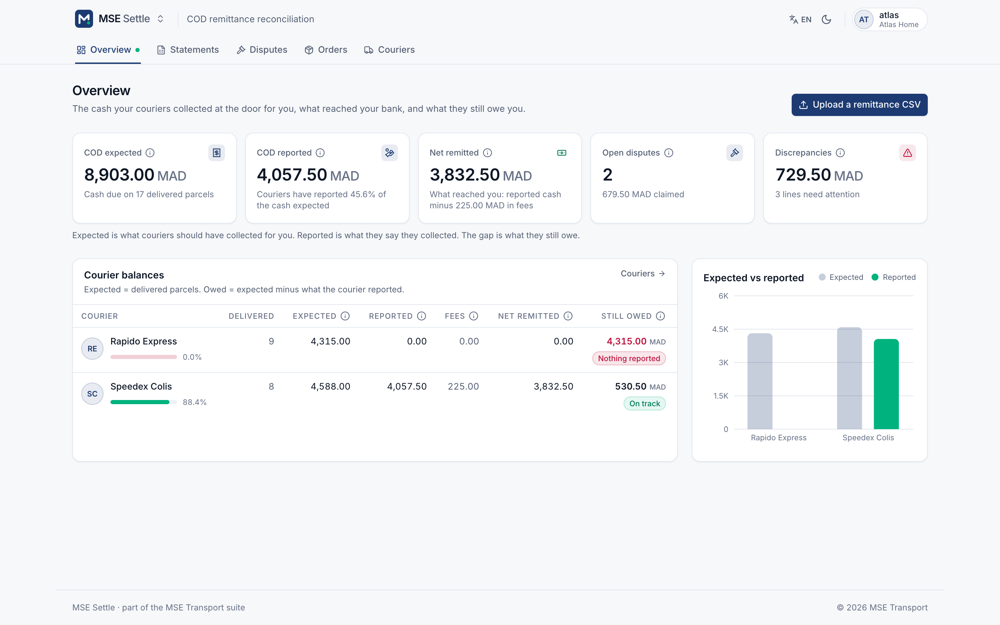
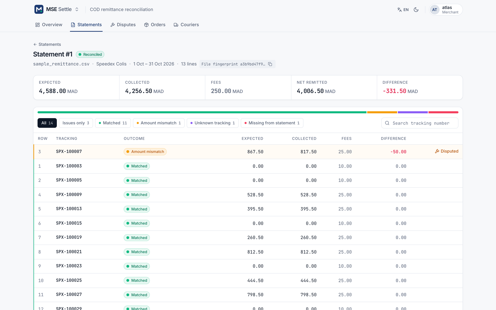
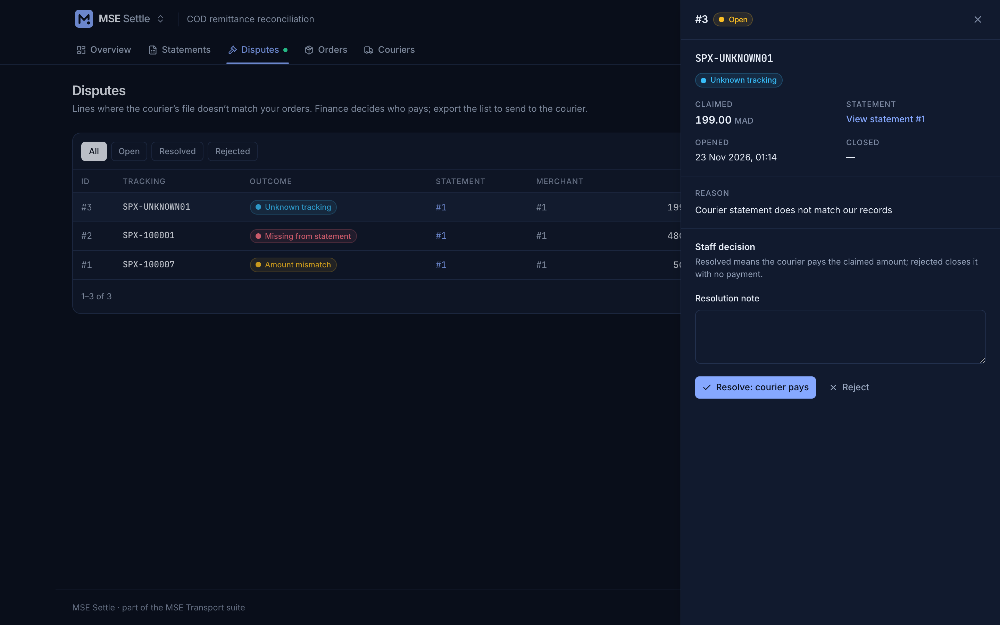

# MSE Settle: product overview



**MSE Settle** is the courier cash settlement product of **MSE Transport**, a software suite for
cash-on-delivery (COD) logistics in Morocco (with MSE Dispatch for live parcel operations and MSE
Copilot for questions over settlement data).

## The problem

Most Moroccan e-commerce orders are paid in cash at the door. The courier keeps a fee and pays the
rest back to the merchant later, with a remittance file. Checking that file against hundreds of
orders by hand is slow, and every mistake is money: a short payment, a parcel the merchant never
shipped, a delivered parcel missing from the file. Merchants find out late and lose track of what
each courier still owes.

## What MSE Settle does

- **Upload** the courier's remittance CSV. Every row is validated at once, and the same file can
  never be imported twice.
- **Reconcile** every line against the merchant's orders, in the background: matched, amount
  mismatch, unknown tracking number, or delivered but missing from the statement.
- **See balances**: cash expected, reported, fees, net remitted and what each courier still owes, in MAD.
- **Dispute** any discrepancy in one click; finance resolves it, and the list exports to CSV.
- For **merchants** (their own data only) and **finance ops** (all merchants), in English or French,
  light or dark.

| Reconciliation | Disputes (finance, dark mode) |
|---|---|
|  |  |

## How it is built

- **Backend**: Java 21, Spring Boot 3.5, Spring Data JPA, PostgreSQL 16 with Flyway, Spring Security
  with stateless JWT, MapStruct, springdoc-openapi.
- **Web app**: React 18, TypeScript (strict), Tailwind with the MSE Transport design tokens,
  TanStack Query, Recharts; served by nginx, which proxies the API on the same origin.
- **Delivery**: Docker Compose (web, API, database, sample data) and GitHub Actions CI.

## Key engineering decisions

- **Money is `BigDecimal`**, `numeric(12,2)` in the database and strings in JSON; the web app
  formats it with integer cents. No floats anywhere on the money path.
- **Idempotent uploads**: a SHA-256 of the file plus a unique constraint per merchant, so a
  re-upload (even two at the same time) returns the existing statement.
- **Processing after commit**: the upload publishes an event that an `@Async`
  `@TransactionalEventListener` handles only once the row is committed; reconciliation is
  row-locked and repeatable.
- **Pure reconciliation engine**: the matching rules are a plain Java function, unit-tested
  without Spring or a database.
- **Tenant isolation in the data layer**: every query is scoped to the caller, so another
  merchant's ID is a 404, never a leak.
- **RFC 7807 errors** everywhere, and Testcontainers PostgreSQL instead of an in-memory database.

## Quality

| Suite | Count |
|---|---|
| Backend unit and slice tests (JUnit 5, Mockito, `@WebMvcTest`) | 176 |
| Backend integration tests (Testcontainers PostgreSQL) | 29 |
| Web app tests (Vitest + Testing Library) | 42 |
| Browser end-to-end (Playwright, upload to dispute resolution) | 1 |

`mvn verify` enforces a JaCoCo line-coverage gate (currently 96.4 % of lines). All suites run in CI.

## Try it

```bash
docker compose up --build -d     # http://localhost:3200, sample account atlas / demo-pass-123
```
