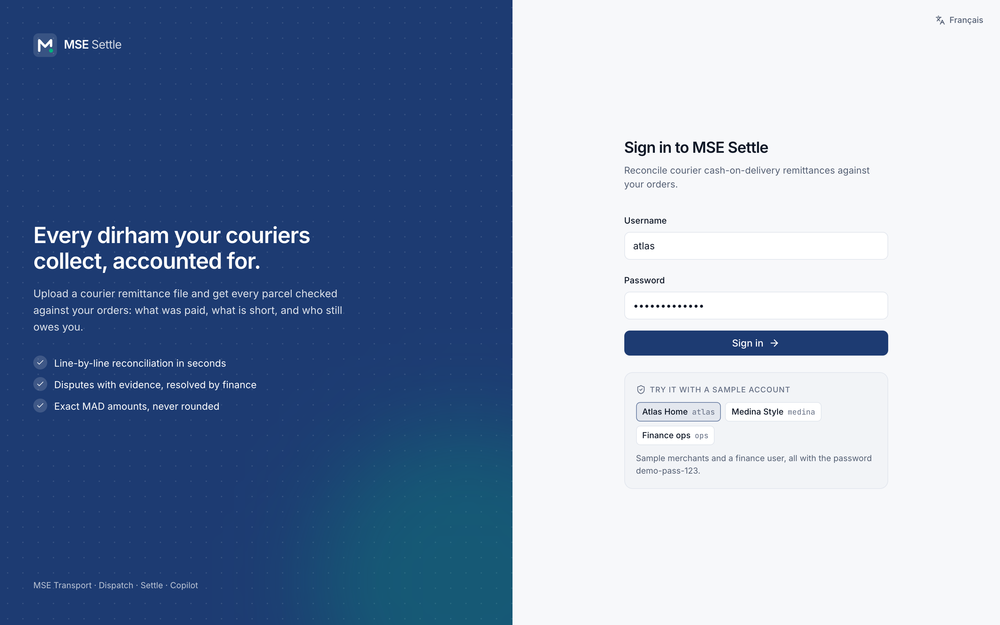
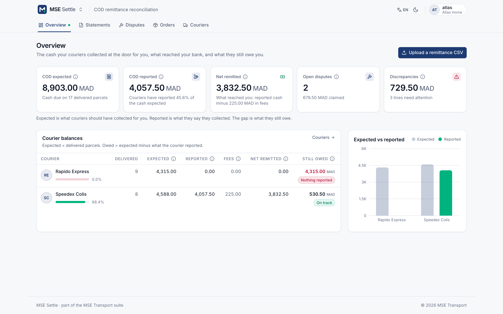
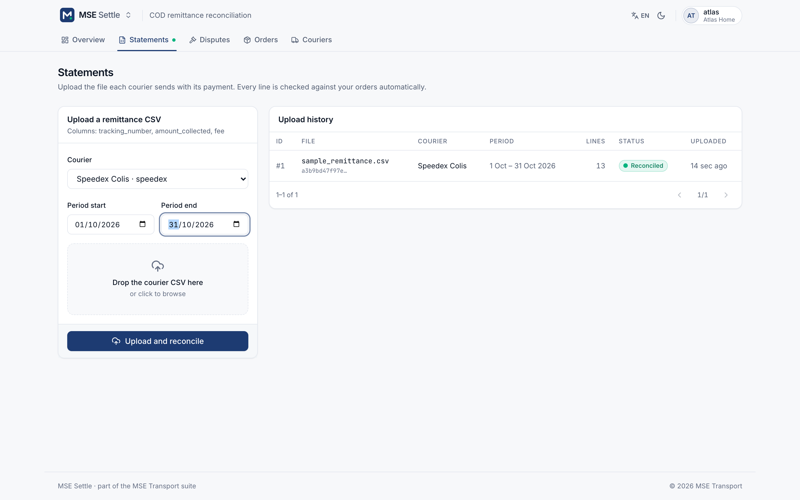
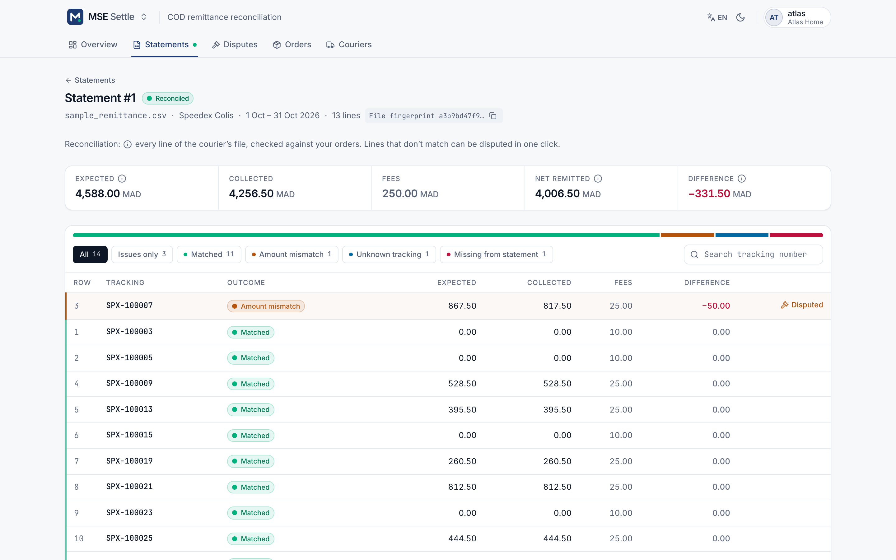
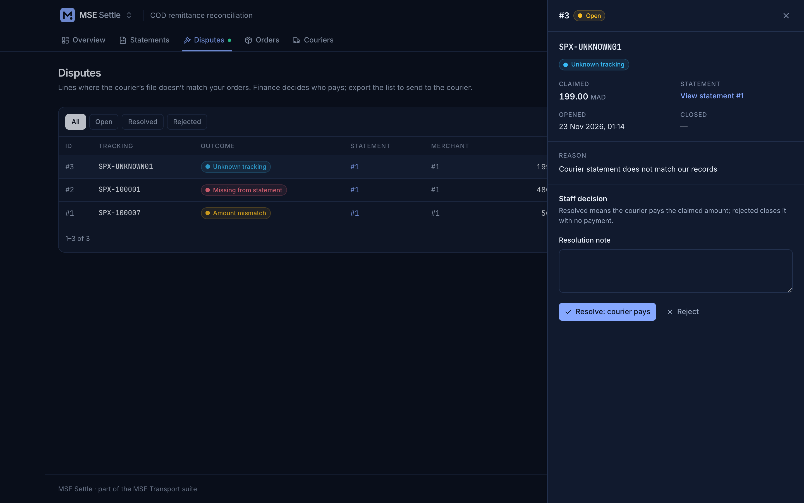
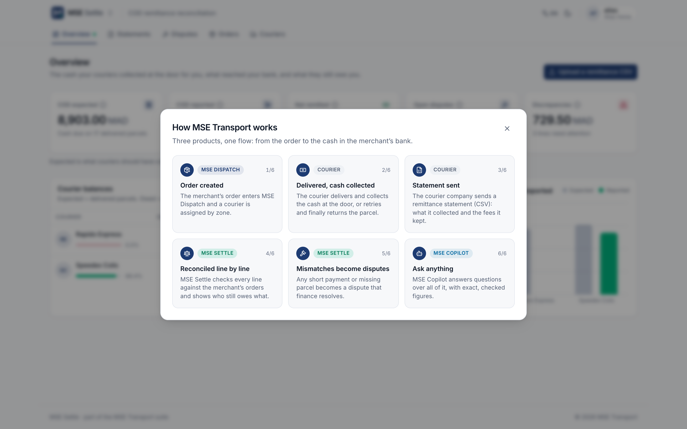

# MSE Settle: the 2-minute tour

MSE Settle checks the cash couriers collect for a merchant. Start the stack with
`docker compose up --build -d` and open http://localhost:3200.

## 1. Sign in as a merchant

The form is filled in with the sample merchant **Atlas Home** (`atlas`). Click **Sign in**. The chips
below switch to the other sample merchant or to the **Finance ops** user (`ops`).

## 2. Read the overview

Five numbers answer "where is my cash?". Hover the ⓘ next to any label for a plain definition.

- **COD expected**: cash due on every delivered parcel.
- **COD reported**: what couriers say they collected, as a share of expected.
- **Net remitted**: what actually reached the bank, after courier fees.
- **Open disputes** and **Discrepancies**: lines that don't match and the money involved.

Below, each courier's balance: the amount still owed, a progress bar (green when on track, red when
nothing has been reported) and one status chip.

## 3. Upload a courier statement

Open **Statements**, choose *Speedex Colis*, period 2026-10-01 → 2026-10-31, and drop
`fixtures/sample_remittance.csv`. The row goes *Queued → Processing → Reconciled* on its own.
Uploading the same file again is refused politely: nothing is imported twice.

## 4. See what doesn't match

Click the statement. 11 lines match; three don't: a short payment (−50.00 MAD), a tracking number
the merchant never shipped, and a delivered parcel missing from the file. **Open dispute** turns a
line into a claim, prefilled with the difference.

## 5. Resolve it as finance

Account menu → **Sign out**, then sign in as **Finance ops** (`ops`). Open **Disputes**, click a
dispute and decide: the courier pays, or the claim is rejected. **Export CSV** produces the list to
send to the courier.

## 6. How it fits together

Account menu → **How it works**: MSE Dispatch delivers the parcels, MSE Settle checks the cash, and
MSE Copilot answers questions about all of it.

